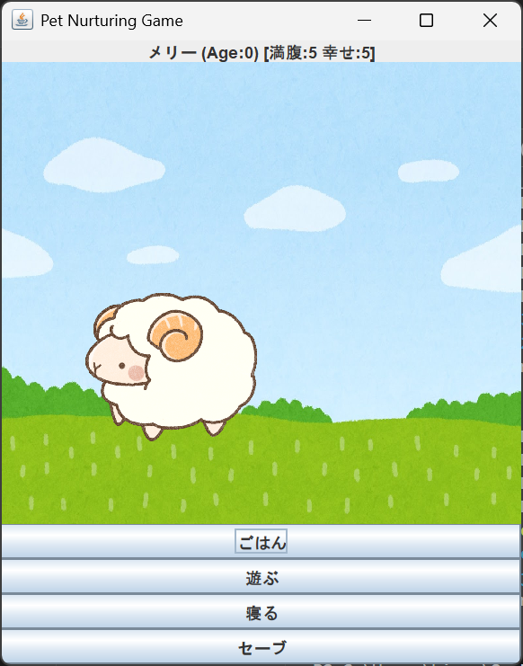
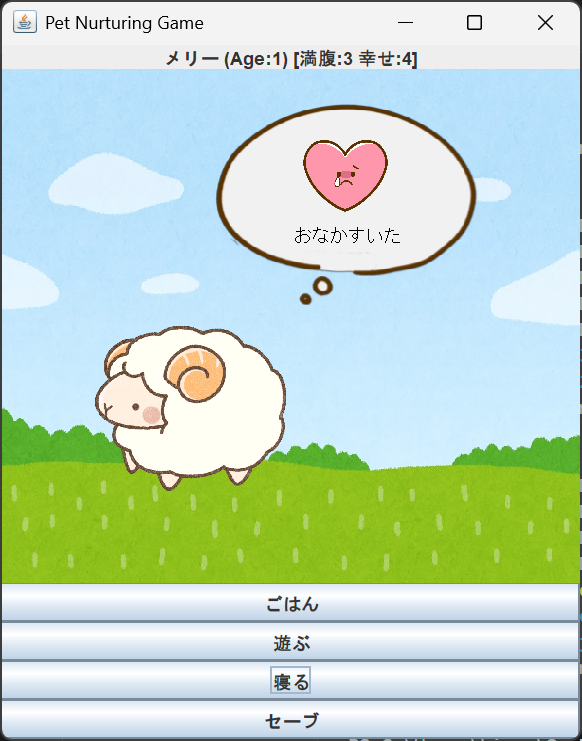
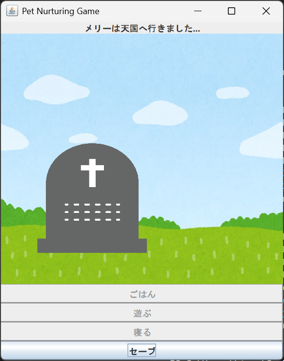
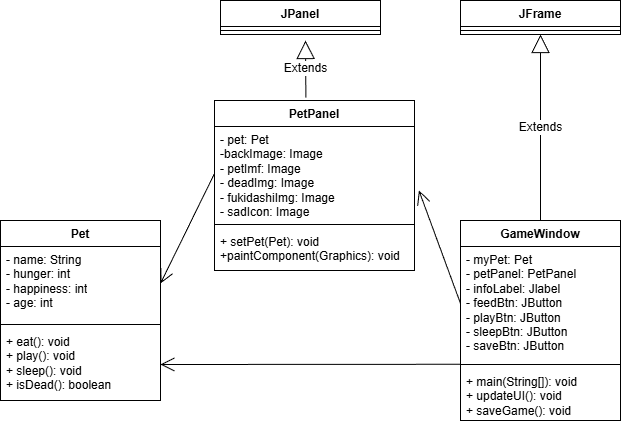
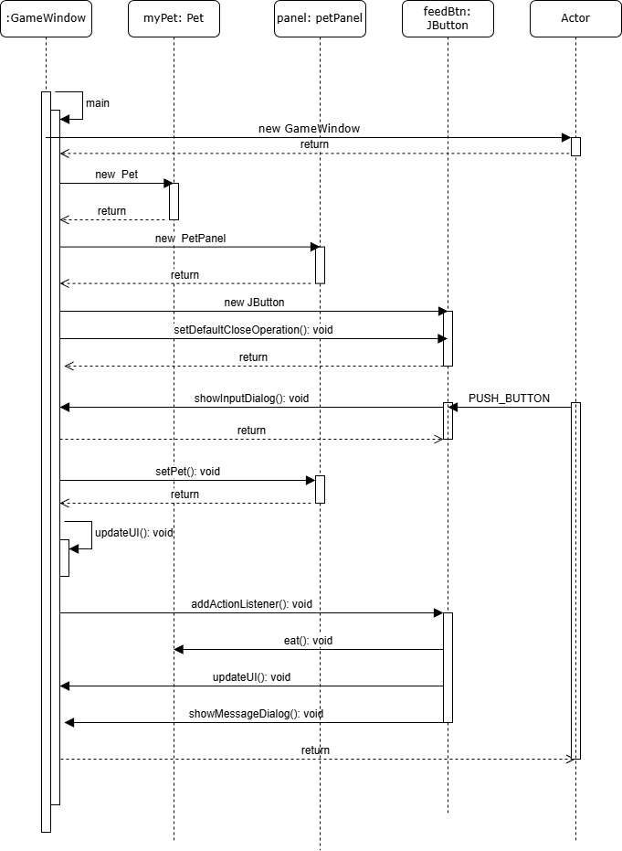

# Pet Nurturing Game 🐑
### ひつじの育成シミュレーションゲーム

## 概要

Javaを用いて制作した、羊を育てるペット育成シミュレーションゲームです。

プレイヤーは羊に「ごはん」「遊ぶ」「寝る」の3つの行動を行い、満腹度や幸福度を管理しながら成長を見守ります。行動によってペットの状態が変化し、満腹度または幸福度が0になるとゲームオーバーになります。

大学の講義「オブジェクト指向設計」の課題として、企画・設計から実装まで取り組みました。

## 使用技術

- Java
- Java Swing（GUI）
- Java Serialization（セーブデータの保存・復元）

## ゲームの主な機能

### 1. ペットの育成

ペットには「満腹度」「幸福度」「年齢」の3つのパラメータがあります。

初期状態は年齢0歳、満腹度5、幸福度5で、満腹度と幸福度はそれぞれ0〜10の範囲で変動します。

| 行動 | 満腹度 | 幸福度 | 年齢 |
|---|---:|---:|---:|
| ごはん | +3 | 変化なし | 変化なし |
| 遊ぶ | -2 | +3 | 変化なし |
| 寝る | -2 | -1 | +1 |

満腹度または幸福度が0になると、ペットは死亡し、ゲームオーバーになります。

### 2. 状態に応じたビジュアル表現

ペットの状態に合わせて、画面上の画像やメッセージが変化します。

- 満腹度または幸福度が3以下になると、吹き出しと専用アイコンを表示
- 空腹時は「おなかすいた」、幸福度が低いときは「さびしいな」と表示
- ペットが死亡すると、羊の画像が墓の画像に切り替わり、操作ボタンが無効化される

### 3. セーブ・ロード機能

JavaのSerializableインターフェースを利用し、ペットの状態をファイル（save.dat）に保存・復元できるようにしました。

プログラムを終了しても育成状況を保持でき、次回起動時に続きからプレイできます。

## ゲーム画面

### メイン画面

### 空腹時の状態表示

### ゲームオーバー画面

## プログラム設計

本プログラムでは、保守性と拡張性を意識し、役割に応じて3つのクラスに分けて実装しました。

### クラス構成

| クラス | 役割 |
|---|---|
| Pet | ペットの名前・満腹度・幸福度・年齢などのデータ管理と、各行動によるステータス更新 |
| PetPanel | ペットの状態に応じた画像や吹き出しなどの画面描画 |
| GameWindow | ウィンドウの構築、ユーザー操作の受付、ゲーム全体の制御、セーブ・ロード |

### クラス図

各クラスの役割と関係を以下に示します。

### シーケンス図

ユーザーが「ごはん」ボタンを押した際の処理の流れを示しています。

GameWindowがユーザーの入力を受け取り、Petのステータスを更新した後、PetPanelに画面の再描画を指示する流れになっています。

## 実装上の工夫

### 1. カプセル化によるデータ管理

Petクラスの満腹度や幸福度などの内部ステータスをprivate変数として管理しました。

外部から直接値を書き換えられないようにし、専用のメソッドを通じて操作することで、ステータスが0〜10の範囲を超えないようにしています。

### 2. クラスごとの役割分担

データ管理・画面描画・ゲーム全体の制御をそれぞれ別のクラスに分けました。

各クラスの役割を明確にすることで、コードの見通しをよくし、機能の追加や変更がしやすい構成を意識しました。

### 3. 状態に応じた画面描画

PetPanelではGraphicsクラスを用いて、背景画像とペットの画像を重ねて描画しています。

また、吹き出しの描画処理をdrawSpeechメソッドとして独立させることで、コードの重複を避け、表示内容を変更・追加しやすいようにしました。

## 制作を通して学んだこと

今回が0から取り組む初めてのアプリケーション制作だったため、実現したい機能を整理し、自分の理解度や実装可能な範囲を考えながら開発を進めました。

必要な技術や実装方法を調べ、試行錯誤を重ねる中で、オブジェクト指向におけるクラスの役割分担やデータ管理の重要性を学びました。

また、講義で個別に学んだ知識を一つのアプリケーションとして組み合わせる難しさと、実際に動くものを完成させる面白さを実感しました。
